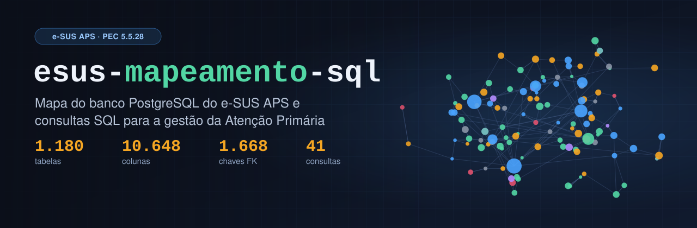
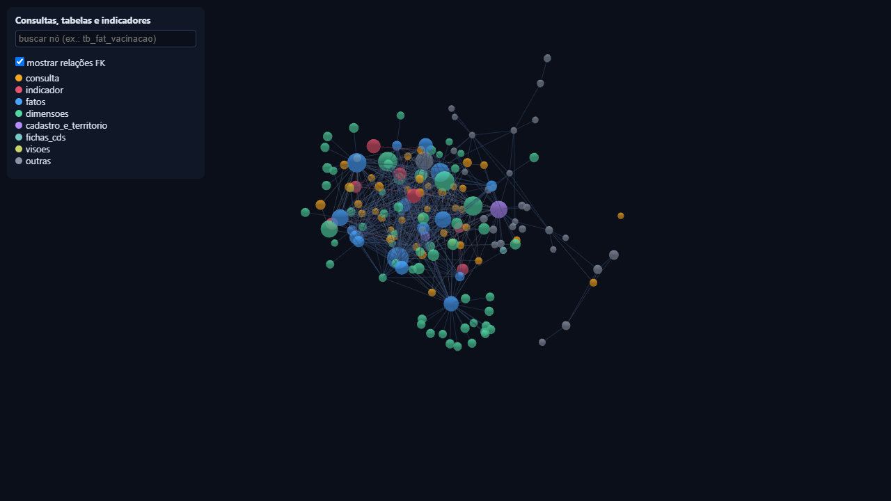

<p align="center">
  
</p>

<p align="center">
  
  
  
  
  
  
  
</p>

Repositório criado para facilitar a vida de quem precisa entender e ler os dados do banco do e-SUS APS, o prontuário eletrônico (PEC) usado nas unidades básicas de saúde do SUS.

Pensado em quem trabalha com TI na saúde pública e mexe com o e-SUS PEC no dia a dia, e em desenvolvedores que estão criando sistemas integrados ao PEC e precisam puxar dados do banco. Se você quer montar um painel, um BI, acompanhar indicadores ou criar alguma ferramenta em cima desses dados, a ideia é que aqui você encontre o caminho mais rápido.

O repositório tem duas partes. A primeira é um mapa de todas as tabelas do PEC, com o que cada coluna guarda e como as tabelas se ligam. A segunda são consultas SQL prontas para coisas que a gente faz o tempo todo na Atenção Primária: achar quem precisa de busca ativa, acompanhar a vacinação, arrumar o cadastro e calcular os indicadores que entram no repasse federal.

Nenhum dado de paciente foi usado. O mapa saiu só da estrutura do banco, e as consultas foram testadas no PostgreSQL 9.6 e no 16.

## Sumário

- [O que você encontra aqui](#o-que-você-encontra-aqui)
- [As consultas](#as-consultas)
- [O mapa do banco](#o-mapa-do-banco)
- [O grafo 3D](#o-grafo-3d)
- [Com o que foi feito](#com-o-que-foi-feito)
- [Como as pastas estão organizadas](#como-as-pastas-estão-organizadas)
- [Como usar](#como-usar)
- [Rodando uma consulta](#rodando-uma-consulta)
- [Cuidados com os dados](#cuidados-com-os-dados)
- [O que você precisa saber antes de usar](#o-que-você-precisa-saber-antes-de-usar)
- [Mais documentação](#mais-documentação)
- [Licença](#licença)

## O que você encontra aqui

| O quê | Quantos | Onde |
|---|--:|---|
| Tabelas do PEC 5.5.28 | 1.180 | [`schema/tables/`](schema/tables) |
| Visões materializadas (`mv_`) | 6 | [`schema/tables/visoes/`](schema/tables/visoes) |
| Colunas descritas | 10.648 | [`schema/schema.json`](schema/schema.json) |
| Chaves estrangeiras | 1.668 | [`schema/schema.json`](schema/schema.json) |
| Consultas SQL | 41, em 5 categorias | [`sql/`](sql) |
| Armadilhas do banco | 16 | [`docs/armadilhas.md`](docs/armadilhas.md) |
| Nós e ligações no grafo | 158 e 538 | [`graph/`](graph) |
| Testes automatizados | 15 | [`tests/`](tests) |

Cada tabela tem uma página só dela, com as colunas, o tipo de cada uma, se é obrigatória, qual é a chave primária e para qual tabela cada chave estrangeira aponta. Os índices da pasta [`docs/`](docs) são montados a partir dos próprios arquivos, então estão sempre batendo com o que tem no repositório.

## As consultas

| Categoria | Quantas | O que tem |
|---|--:|---|
| [`indicadores_cofinanciamento`](sql/indicadores_cofinanciamento) | 12 | Cálculo dos indicadores do cofinanciamento federal da APS por equipe, e conferência pessoa a pessoa |
| [`busca_ativa`](sql/busca_ativa) | 12 | Listas de quem está sem o acompanhamento que deveria ter: gestantes, hipertensos, diabéticos, preventivo do colo do útero, M-CHAT, Bolsa Família |
| [`imunizacao`](sql/imunizacao) | 8 | Doses aplicadas, cobertura do esquema básico, vacina atrasada, abandono entre D1 e D3, lote perto de vencer, dose inválida |
| [`cadastro_e_territorio`](sql/cadastro_e_territorio) | 7 | Cadastro individual vencido, CPF duplicado, visitas de ACS por desfecho, gente atendida sem cadastro no território, validação de CNS |
| [`modelagem_dw`](sql/modelagem_dw) | 2 | Jeitos seguros de juntar tabelas no Data Warehouse do PEC e uma camada de staging |

Os indicadores que já têm consulta própria são C1 (mais acesso), C3 (pré-natal), C4 (diabetes), C5 (hipertensão), C7 (preventivo do colo do útero), B3 (exodontia) e M1 (atendimentos da eMulti), além da dimensão cadastro do vínculo. Conferi as regras de C1, C3, C4, C7, B3, M1 e do vínculo com as notas metodológicas do Ministério da Saúde. A lista completa, com as tabelas e os parâmetros de cada consulta, está em [`docs/indice_consultas.md`](docs/indice_consultas.md).

Todo arquivo começa com um cabeçalho igual a este, e é dele que saem os índices e o grafo:

```sql
-- titulo: Indicador C5: Validação Nominal por Pessoa (Hipertensão)
-- categoria: indicadores_cofinanciamento
-- indicador: C5
-- tabelas: tb_acomp_cidadaos_vinculados, tb_dim_cbo, tb_dim_equipe, ...
-- parametros: cpf, fim, ine_1, ine_2, ine_3, ini12, ini6
-- uso: somente leitura (SET default_transaction_read_only = on)
-- limitacoes: DISTINCT ON sem ORDER BY no CTE alvo; a prática B só olha o atendimento individual
```

Vale olhar a linha `limitacoes` antes de levar o número para um relatório. É ali que eu anoto onde a consulta simplifica a regra oficial.

## O mapa do banco

Separei as tabelas pelo prefixo e pelo papel que elas têm no banco:

| Grupo | Tabelas | O que guarda |
|---|--:|---|
| [`fatos`](schema/tables/fatos) | 54 | Fatos do Data Warehouse (`tb_fat_*`) |
| [`dimensoes`](schema/tables/dimensoes) | 95 | Dimensões do Data Warehouse (`tb_dim_*`) |
| [`fichas_cds`](schema/tables/fichas_cds) | 43 | Fichas da Coleta de Dados Simplificada (`tb_cds_*`) |
| [`cadastro_e_territorio`](schema/tables/cadastro_e_territorio) | 10 | Cidadão, domicílio e vínculo com a equipe |
| [`outras`](schema/tables/outras) | 440 | O resto das tabelas `tb_` do prontuário |
| [`relacionamentos`](schema/tables/relacionamentos) | 89 | Tabelas de ligação (`rl_`) |
| [`log_revisoes`](schema/tables/log_revisoes) | 256 | Histórico de alterações dos registros (`tl_`, Envers) |
| [`auditoria`](schema/tables/auditoria) | 193 | Trilha de auditoria gravada por trigger (`ta_`) |
| [`visoes`](schema/tables/visoes) | 6 | Visões materializadas (`mv_`) |

Só entram os prefixos que vêm de fábrica no PEC (`tb_`, `tl_`, `ta_`, `rl_`, `mv_`). Visões que alguém criou numa instalação, como `stg_*` e `vw_*`, ficam de fora, porque o mapa é do sistema e não de um município. O índice completo está em [`docs/indice_tabelas.md`](docs/indice_tabelas.md).

## O grafo 3D

O [`graph/viewer.html`](graph/viewer.html) mostra num desenho só as consultas, as tabelas que cada uma usa, as ligações entre essas tabelas e os indicadores que saem delas. A biblioteca já vem dentro do arquivo, então é só abrir no navegador, sem servidor e sem internet.



Clicando num ponto, a câmera vai até ele. Na caixa de busca você digita o nome de uma tabela para destacá-la, e a caixinha de seleção mostra ou esconde as chaves estrangeiras.

## Com o que foi feito

| Parte | Tecnologia | Para quê |
|---|---|---|
| Banco | PostgreSQL 9.6 a 16 | É o banco do e-SUS PEC. Daqui saem a estrutura (`pg_catalog`, `information_schema`) e os testes com `EXPLAIN` |
| Scripts | Python 3.11+ | Extrair o esquema, juntar as consultas, validar, gerar o grafo e auditar antes de publicar |
| Driver | [psycopg 3](https://www.psycopg.org/psycopg3/) | Conectar no PostgreSQL só para leitura |
| Leitura de SQL | [sqlglot](https://github.com/tobymao/sqlglot) | Entender as consultas no dialeto do PostgreSQL e trocar valores fixos por parâmetros |
| Visualização | [3d-force-graph](https://github.com/vasturiano/3d-force-graph) (Three.js/WebGL) | Desenhar o grafo 3D num HTML que abre sozinho |
| Testes | `unittest` e Node.js (opcional) | Ver se esquema, índices e grafo batem entre si e se o JavaScript do visualizador está certo |

## Como as pastas estão organizadas

```
esus-mapeamento-sql/
├── sql/                     consultas, uma pasta por categoria
├── schema/
│   ├── schema.json          o esquema inteiro em JSON
│   └── tables/<grupo>/      uma página por tabela
├── graph/
│   ├── graph.json           pontos e ligações do grafo
│   ├── viewer.html          visualizador 3D (funciona offline)
│   └── vendor/              biblioteca 3d-force-graph
├── docs/                    índices, armadilhas, histórico e imagens
├── scripts/
│   ├── extract_schema.py    tira a estrutura do banco
│   ├── harvest_sql.py       junta consultas a partir de notas em Markdown
│   ├── validate_sql.py      testa todas as consultas com EXPLAIN
│   ├── build_graph.py       monta o grafo, o visualizador e os índices
│   └── audit_publicacao.py  procura dado pessoal e senha antes de publicar
└── tests/                   testes (os que precisam de banco são pulados sem conexão)
```

## Como usar

Se você só quer consultar o mapa e as consultas, não precisa instalar nada. É só navegar pelas pastas aqui no GitHub ou baixar e abrir o `viewer.html`.

Para extrair o esquema do seu banco ou testar as consultas nele, você vai precisar do Python 3.11 ou mais novo e de um usuário com permissão só de leitura num banco do e-SUS PEC (PostgreSQL 9.6 ou mais novo).

### 1. Preparar o ambiente

No Windows (PowerShell):

```powershell
git clone https://github.com/weesrnp/esus-mapeamento-sql.git
cd esus-mapeamento-sql
py -3 -m venv .venv
.venv\Scripts\python.exe -m pip install -r requirements.txt
```

No Linux ou no macOS:

```bash
git clone https://github.com/weesrnp/esus-mapeamento-sql.git
cd esus-mapeamento-sql
python3 -m venv .venv
.venv/bin/pip install -r requirements.txt
```

### 2. Apontar para o banco

Os scripts pegam a conexão das variáveis de ambiente do PostgreSQL (`PGHOST`, `PGPORT`, `PGDATABASE`, `PGUSER`, `PGPASSWORD`) ou da `DATABASE_URL`. Eles não leem arquivo de configuração e não salvam a senha em lugar nenhum.

```powershell
$env:PGHOST="servidor"; $env:PGPORT="5433"; $env:PGDATABASE="esus"
$env:PGUSER="usuario_leitura"; $env:PGPASSWORD="..."
```

### 3. Extrair o esquema, montar o grafo e testar as consultas

```powershell
.venv\Scripts\python.exe scripts\extract_schema.py   # lê só a estrutura do banco
.venv\Scripts\python.exe scripts\build_graph.py      # grafo, visualizador e índices
.venv\Scripts\python.exe scripts\validate_sql.py     # EXPLAIN em cada consulta, sem ler dados
```

O validador abre a conexão em modo somente leitura, com limite de 30 segundos por comando, e mostra se cada arquivo passou. Se quiser guardar o resultado, use `--report relatorio.json` ou `--report-md relatorio.md`. Para testar uma consulta só, use `--file`.

### 4. Rodar os testes

```powershell
.venv\Scripts\python.exe -m unittest discover -s tests -v
```

Num clone novo, os testes que dependem de banco, de Node.js ou do arquivo de termos privados são pulados.

### Trazer consultas das suas anotações

Se você guarda SQL em notas Markdown, dá para trazer tudo de uma vez:

```powershell
.venv\Scripts\python.exe scripts\harvest_sql.py --out sql PASTA_OU_ARQUIVO.md
```

O script pega os blocos ```` ```sql ````, troca códigos de equipe ou de município por parâmetros (`:ine_1`) e deixa de fora qualquer bloco que tenha CPF, CNS, IP ou senha.

## Rodando uma consulta

Os parâmetros são variáveis do `psql` (`:nome`) e você passa com `-v`. As datas vão no formato `YYYYMMDD`, igual ao `co_dim_tempo` do banco. O código INE aparece entre aspas nos arquivos (`:'ine_1'`) para não perder os zeros do começo.

```bash
PGOPTIONS="-c default_transaction_read_only=on -c statement_timeout=30000" \
psql -v fim=20260831 -v ine_1=0000000000 \
     -f sql/busca_ativa/02_mulheres_de_25_a_64_anos_sem_rastreamento_do_colo_do_utero.sql
```

No DBeaver, no pgAdmin ou em outro cliente, troque os parâmetros pelos valores antes de rodar.

## Cuidados com os dados

- Rode sempre com um usuário só de leitura e com limite de 30 segundos por comando. Nenhum script daqui grava nada no banco.
- As listas com nome de pessoa mostram o CPF ou o CNS mascarado e não trazem endereço, telefone, nome da mãe nem NIS. Trate o resultado de acordo com a LGPD e não acrescente esses campos.
- Aqui não tem dado de paciente, nome de pessoa ou de município, endereço de rede nem senha.
- Se for publicar um fork ou alguma mudança, rode a auditoria antes e só publique se ela não achar nada:

```powershell
.venv\Scripts\python.exe scripts\audit_publicacao.py
```

O script procura CPF, CNS, IP, senha, caminho de pasta do seu computador e código de equipe. Coisas específicas da sua instalação, como nomes de pessoas e do seu município, você coloca num arquivo de expressões regulares fora do repositório e aponta pela variável `ESUS_TERMOS_PRIVADOS`.

## O que você precisa saber antes de usar

- O mapa é da versão 5.5.28 do PEC. Em outras versões pode faltar ou sobrar tabela e coluna, então rode o `extract_schema.py` e o `validate_sql.py` no seu banco antes de confiar numa consulta.
- Alguns códigos mudam de uma versão para outra, como tipo de atendimento, desfecho de visita e motivo de saída do cadastro. Por isso as consultas buscam esses valores pela descrição, mas vale conferir na sua instalação.
- A consulta [`04_funcao_pl_pgsql_no_postgresql.sql`](sql/cadastro_e_territorio/04_funcao_pl_pgsql_no_postgresql.sql) cria a função `fn_validar_cns`. Como ela cria um objeto no banco, não roda em modo somente leitura e está marcada como `status: revisar`. Use num banco de apoio.
- Os indicadores daqui servem para acompanhar e conferir os números localmente. O resultado que vale é o que o Ministério da Saúde publica com os dados enviados ao SISAB.

## Mais documentação

- [Índice de consultas](docs/indice_consultas.md): título, indicador, tabelas e parâmetros de cada SQL
- [Índice de tabelas](docs/indice_tabelas.md): as 1.186 páginas do esquema, por grupo
- [Armadilhas do banco](docs/armadilhas.md): 16 coisas que costumam dar número errado, como data guardada como número inteiro, linhas que se multiplicam ao juntar subfatos e a mesma pessoa aparecendo várias vezes no DW
- [Histórico de alterações](docs/CHANGELOG.md)

## Licença

[MIT](LICENSE). O esquema descrito aqui é do e-SUS APS, sistema do Ministério da Saúde. Este repositório não distribui o sistema nem dados, e não tem nenhum vínculo com o Ministério.
